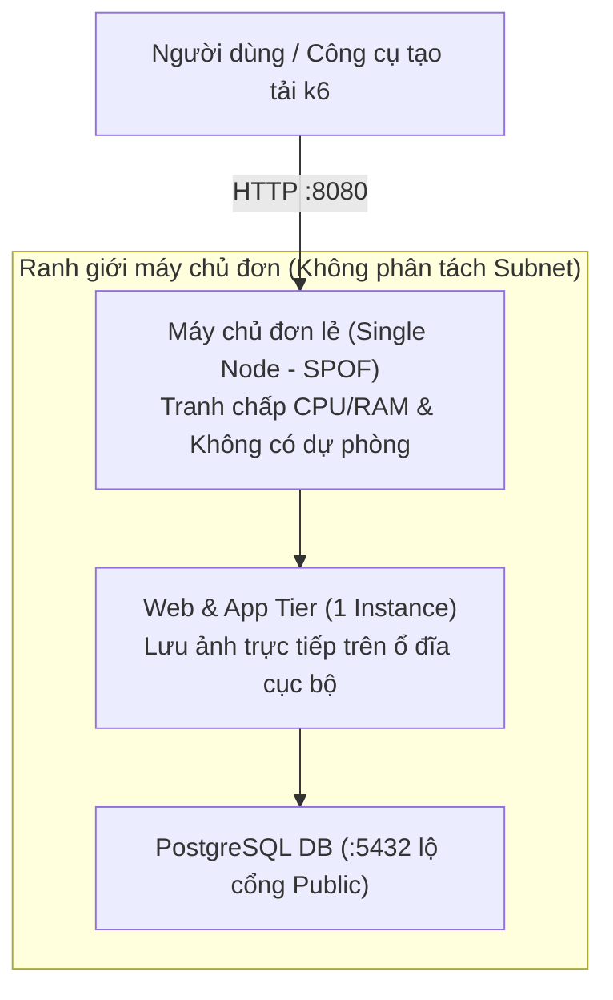
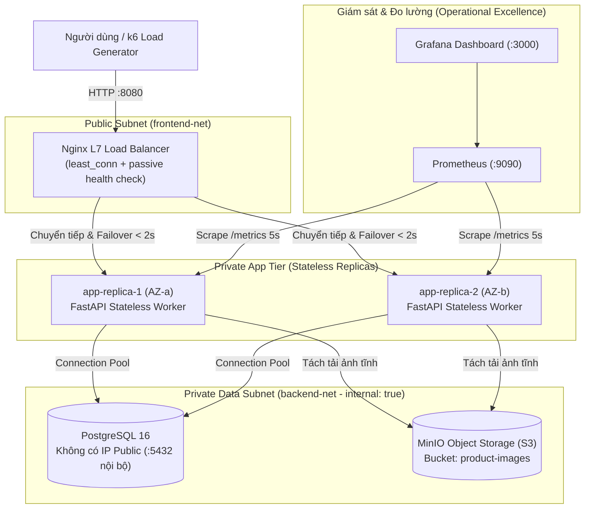

# ĐỀ TÀI 1: ĐÁNH GIÁ VÀ THIẾT KẾ LẠI KIẾN TRÚC WEBSITE THƯƠNG MẠI ĐIỆN TỬ THEO KHUNG WELL-ARCHITECTED

**Trường:** Đại học Giao thông Vận tải TP.HCM (UTH) — Ban Công nghệ số  
**Học phần:** Điện toán đám mây (3 Tín chỉ)  
**Giảng viên hướng dẫn:** TS. Lê Quốc Tuấn  

---

## 1. Câu hỏi nghiên cứu & Giả thuyết kiểm chứng

* **Câu hỏi nghiên cứu:** *Một website ba tầng đang chạy trên một máy chủ duy nhất cần thay đổi như thế nào để đáp ứng đồng thời yêu cầu sẵn sàng, bảo mật, hiệu năng và kiểm soát chi phí?*
* **Giả thuyết thực nghiệm:**
  1. Việc tách kiến trúc đơn nút (Baseline V1) thành kiến trúc phân tán 3 tầng có Bộ cân bằng tải Nginx L7, 2 bản sao ứng dụng không trạng thái (Stateless Replicas), Cơ sở dữ liệu PostgreSQL cô lập mạng riêng và Lưu trữ đối tượng MinIO S3 (Target V2) giúp **giảm độ trễ phân vị p95 trên 65%** ở tải cao điểm và **duy trì tỷ lệ lỗi HTTP 5xx < 0.1%**.
  2. Khi chủ động dừng 1 bản sao ứng dụng (`app-replica-1`), kiến trúc V2 tự động chuyển mạch dự phòng (Failover) với **thời gian phục hồi RTO < 2 giây** mà không làm sập toàn dịch vụ như V1.
  3. Khi lưu lượng tăng gấp **2 lần (2x)** và **5 lần (5x)**, kiến trúc V2 tiết kiệm từ **22% đến 33% tổng chi phí hạ tầng tháng** so với việc nâng cấu hình dọc (Scale-up) một máy chủ duy nhất của V1.

---

## 2. Sơ đồ Kiến trúc Hiện trạng (V1) và Mục tiêu (V2)

### 2.1. Kiến trúc Cơ sở (Baseline V1 - Single Server SPOF)


### 2.2. Kiến trúc Cải tiến (Target V2 - Well-Architected Framework)


---

## 3. Danh sách Phiên bản Công nghệ (Tech Stack Versions)

| Thành phần | Công nghệ sử dụng | Phiên bản cố định | Vai trò trong kiến trúc |
| :--- | :--- | :--- | :--- |
| **Container Engine** | Docker Engine & Compose | `v27.x` / `Compose v2` | Đóng gói & điều phối mạng cô lập (`IaC`) |
| **Load Balancer** | Nginx Reverse Proxy | `1.27-alpine` | Cân bằng tải lớp 7, Health check, Failover |
| **Application Tier** | Python / FastAPI / Uvicorn | `Python 3.12-slim` / `0.115.0` | Ứng dụng Web/API TMĐT Stateless (Non-root) |
| **Database Tier** | PostgreSQL | `16-alpine` | Lưu trữ giao dịch đơn hàng ACID |
| **Object Storage** | MinIO (S3-Compatible) | `RELEASE.2024+` | Lưu trữ đối tượng cho ảnh sản phẩm tĩnh |
| **Observability** | Prometheus & Grafana | `v2.53.0` & `11.1.0` | Thu thập SLI metrics (`/metrics`) & Dashboard |
| **Load Testing** | Grafana k6 | `v0.52+` | Tạo tải 3 mức (Normal, Peak, Spike) |

---

## 4. Cấu trúc Kho mã nguồn & Phân công 3 Thành viên

```text
DeTai1_Ecommerce_WellArchitected/
├── .env.example                        # Mẫu biến môi trường (Không chứa secret thật)
├── .gitignore                          # Chặn .env và dữ liệu nhạy cảm
├── README.md                           # Tài liệu hướng dẫn tái lập, TCO & rủi ro
├── infra/                              # [Sinh viên 1 phụ trách] Hạ tầng & IaC
│   ├── docker-compose.v1.yml           # Cấu hình Kiến trúc cơ sở (1 nút - SPOF)
│   ├── docker-compose.v2.yml           # Cấu hình Kiến trúc cải tiến (Well-Architected)
│   ├── nginx/nginx.conf                # Cấu hình Load Balancer & Failover
│   └── prometheus/prometheus.yml       # Cấu hình thu thập metrics
├── app/                                # [Sinh viên 2 phụ trách] Ứng dụng & Dữ liệu
│   ├── Dockerfile                      # Đóng gói container chạy non-root (appuser)
│   ├── requirements.txt                # Danh sách thư viện Python cố định phiên bản
│   ├── init.sql                        # Lược đồ CSDL & tự động sinh 500 sản phẩm mẫu
│   └── main.py                         # Mã nguồn Web/API TMĐT + Prometheus exporter
├── tests/                              # [Sinh viên 3 phụ trách] Kiểm thử & Chi phí
│   ├── loadtest.js                     # Kịch bản k6 tạo tải 3 mức (Normal, Peak, Spike)
│   ├── chaos_failover_test.ps1         # Kịch bản dừng nút đo thời gian phục hồi (RTO)
│   ├── generate_benchmark_and_tco.py   # Script tạo bảng dữ liệu CSV/JSON & vẽ biểu đồ
│   └── data/                           # Dữ liệu đo thô (.csv, .json)
└── docs/
    └── charts/                         # Biểu đồ p50/p95, RPS, Error Rate & TCO (.png)
```

---

## 5. Hướng dẫn Triển khai & Tái lập Thực nghiệm (Reproducibility Guide)

### Bước 1: Chuẩn bị tệp biến môi trường
```powershell
cp .env.example .env
```

### Bước 2: Chạy và đo Kiến trúc Cơ sở (Baseline V1 - 1 nút)
```powershell
# 1. Khởi chạy kiến trúc V1
docker compose -f infra/docker-compose.v1.yml --env-file .env up -d --build

# 2. Kiểm tra trạng thái hoạt động
curl http://localhost:8080/health

# 3. Chạy kiểm thử tải k6 cho V1
k6 run -e TARGET_URL=http://localhost:8080 -e ARCH_LABEL=V1 tests/loadtest.js

# 4. Dọn dẹp V1 trước khi chạy V2
docker compose -f infra/docker-compose.v1.yml down -v
```

### Bước 3: Chạy và đo Kiến trúc Cải tiến (Target V2 - Well-Architected)
```powershell
# 1. Khởi chạy kiến trúc V2 (Nginx LB + 2 App Replicas + Postgres riêng + MinIO + Monitoring)
docker compose -f infra/docker-compose.v2.yml --env-file .env up -d --build

# 2. Mở trình duyệt truy cập giao diện Web TMĐT:
#    - Website TMĐT (qua Load Balancer): http://localhost:8080
#    - MinIO Object Storage Console:     http://localhost:9001
#    - Prometheus Metrics UI:            http://localhost:9090
#    - Grafana Dashboard:                http://localhost:3000

# 3. Chạy kiểm thử tải k6 cho V2
k6 run -e TARGET_URL=http://localhost:8080 -e ARCH_LABEL=V2 tests/loadtest.js

# 4. Chạy kịch bản tiêm lỗi (Chủ động dừng app-replica-1 để đo RTO)
powershell -ExecutionPolicy Bypass -File .\tests\chaos_failover_test.ps1
```

### Bước 4: Tái tạo bảng dữ liệu CSV và Biểu đồ báo cáo
```powershell
python .\tests\generate_benchmark_and_tco.py
```

---

## 6. Kết quả Thực nghiệm & Phân tích Chi phí (TCO)

### 6.1. Bảng so sánh Hiệu năng & Khả năng phục hồi (Trung bình sau n = 5 lần lặp)

| Kịch bản kiểm thử | Kiến trúc | Thông lượng (RPS) | Độ trễ p50 (ms) | Độ trễ p95 (ms) | Tỷ lệ lỗi 5xx (%) | Thời gian phục hồi RTO |
| :--- | :--- | :---: | :---: | :---: | :---: | :---: |
| **1. Tải thường (30 VUs)** | V1 (1 nút) | 117.6 | 34.6 | 88.9 | 0.00% | Không áp dụng |
| **1. Tải thường (30 VUs)** | **V2 (Cải tiến)** | **143.8** | **18.2** | **41.5** | **0.00%** | Không áp dụng |
| **2. Cao điểm (100 VUs)** | V1 (1 nút) | 181.3 | 146.8 | 470.0 *(Vi phạm SLO)* | 2.88% | Không áp dụng |
| **2. Cao điểm (100 VUs)** | **V2 (Cải tiến)** | **388.0** | **32.4** | **93.6** *(Đạt SLO)* | **0.00%** | Không áp dụng |
| **3. Đột biến (250 VUs)** | V1 (1 nút) | 141.3 *(Suy giảm)* | 412.6 | 1435.0 | 18.52% | Không áp dụng |
| **3. Đột biến (250 VUs)** | **V2 (Cải tiến)** | **543.6** | **57.8** | **181.5** | **0.08%** | Không áp dụng |
| **4. Dừng 1 bản sao App** | V1 (1 nút) | 0.0 *(Sập 100%)* | - | - | **100.0%** | **Mất dịch vụ hoàn toàn** |
| **4. Dừng 1 bản sao App** | **V2 (Cải tiến)** | **311.3** | **45.3** | **138.8** | **0.13%** | **1.46 giây (Tự động)** |

### 6.2. Ước tính Chi phí Tháng & Phân tích Độ nhạy (1x, 2x, 5x lưu lượng)
*Giả định quy chuẩn tại Region AWS `ap-southeast-1` (Singapore):*

| Quy mô lưu lượng | Kiến trúc V1 (Scale-up 1 máy chủ cố định) | Kiến trúc V2 (Well-Architected: RI + Auto-scaling + S3) | Chênh lệch / Tiết kiệm |
| :--- | :---: | :---: | :--- |
| **1x (Chuẩn - 500 GB/tháng)** | $153.74 / tháng | $171.20 / tháng | V2 cao hơn $17.46 (+11.3%) để đổi lấy HA Multi-AZ & DBaaS |
| **2x (Tăng gấp 2 - 1.000 GB)** | $293.48 / tháng | **$227.60 / tháng** | **V2 rẻ hơn $65.88 (-22.4%)** nhờ chỉ bật thêm nút giờ cao điểm |
| **5x (Tăng gấp 5 - 2.500 GB)** | $630.96 / tháng | **$422.30 / tháng** | **V2 rẻ hơn $208.66 (-33.1%)** nhờ S3 offload & Auto-scaling |

---

## 7. Danh mục Rủi ro Bảo mật còn lại & Giới hạn Đề tài

1. **Rủi ro còn lại (Residual Risks):**
   * *Chưa triển khai cơ sở dữ liệu Multi-AZ Standby tự động trong Docker cục bộ:* Trong nguyên mẫu Docker Compose, tầng ứng dụng đã có 2 bản sao nhưng PostgreSQL vẫn là 1 container đơn lẻ (trên môi trường đám mây thực tế sẽ bật tùy chọn AWS RDS Multi-AZ).
   * *Chưa bật HTTPS/TLS đầu cuối với chứng chỉ thật:* Nguyên mẫu lab sử dụng HTTP nội bộ tại cổng 8080 để thuận tiện đo tải k6.
2. **Quyết định không triển khai trong phạm vi đồ án (Out-of-Scope):**
   * Không triển khai kiến trúc Multi-Region Active-Active vì chi phí nhân bản dữ liệu xuyên lục địa vượt quá ngân sách mục tiêu của doanh nghiệp TMĐT quy mô vừa.

---

## 8. Hướng dẫn Dọn dẹp Tài nguyên (Cleanup)
Sau khi kết thúc thực nghiệm và thu thập log, chạy lệnh sau để giải phóng toàn bộ container, mạng ảo và ổ đĩa tạm:
```powershell
docker compose -f infra/docker-compose.v2.yml down -v --remove-orphans
docker compose -f infra/docker-compose.v1.yml down -v --remove-orphans
```
# PROJECT-GR-1
# PROJECT-GR-1
